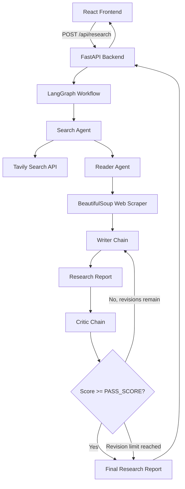
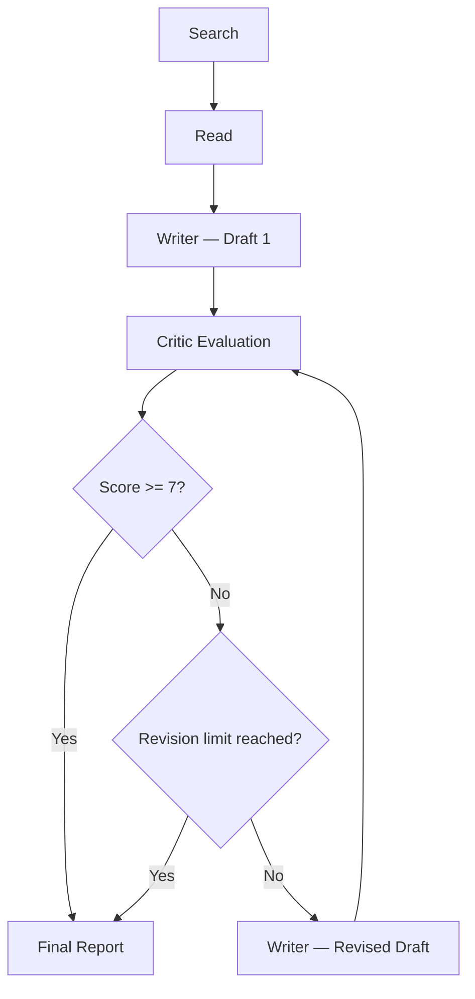

# 🧠 ResearchMind
### Multi-Agent AI Research System

**ResearchMind** is an AI-powered multi-agent research system that autonomously investigates topics, discovers relevant web sources, extracts information, generates structured research reports, and evaluates their quality through a dedicated Critic agent.

Built with **LangChain, LangGraph, FastAPI, React, and OpenRouter**, ResearchMind transforms a simple research query into a comprehensive, evidence-oriented report through a collaborative AI workflow.

---

## ✨ Features

- 🔎 **Intelligent Web Search** — Discovers relevant articles, reports, and sources using Tavily.
- 📖 **Automated Web Scraping** — Extracts meaningful information from webpages using BeautifulSoup.
- ✍️ **AI Report Generation** — Creates structured Markdown research reports with findings, analysis, conclusions, and sources.
- 🧐 **Dedicated Critic Agent** — Evaluates reports and provides scores, strengths, and actionable feedback.
- 🔄 **Iterative Refinement** — Uses conditional LangGraph routing to send reports back for revision when they fail to meet the quality threshold.
- 📚 **Source-Aware Research** — Preserves source URLs to support report citations and verification.
- 📄 **Markdown Rendering** — Displays formatted reports, tables, headings, and lists.
- ⬇️ **Report Export** — Download generated research reports in Markdown format.
- ⚡ **Interactive Interface** — A clean React-based interface for submitting topics and viewing results.

---

## 🏗️ System Architecture

ResearchMind follows a decoupled frontend-backend architecture, with LangGraph orchestrating the multi-agent research workflow.



### Technology Stack

| Layer | Technologies |
|---|---|
| Frontend | React, Vite, JavaScript, CSS |
| Backend | Python, FastAPI |
| Agent Framework | LangChain, LangGraph |
| LLM Provider | OpenRouter |
| Web Search | Tavily API |
| Web Scraping | BeautifulSoup, Requests |
| Report Format | Markdown |
| Deployment | Render |

---

## 🤖 Multi-Agent Workflow

ResearchMind uses four specialized AI components to complete the research process.

### 01 — Search Agent 🔎

**Function:** `build_search_agent()`

- Searches the web using Tavily API.
- Retrieves relevant articles, titles, URLs, and snippets.
- Collects information related to the research topic.
- Provides source material for the Reader Agent.

### 02 — Reader Agent 📖

**Function:** `build_reader_agent()`

- Analyzes search results.
- Identifies relevant URLs.
- Scrapes webpage content using BeautifulSoup.
- Removes unnecessary HTML elements such as scripts, styles, navigation, and footers.
- Extracts useful information and preserves source URLs.

### 03 — Writer Chain ✍️

**Function:** `writer_chain`

- Combines retrieved research and extracted evidence.
- Generates a structured Markdown report.
- Incorporates Critic feedback during revisions.
- Produces sections such as:
  - Introduction
  - Key Findings
  - Detailed Analysis
  - Methodology
  - Limitations
  - Conclusion
  - Sources

### 04 — Critic Chain 🧐

**Function:** `critic_chain`

Evaluates the generated report using criteria such as:

- Factual accuracy
- Source quality
- Citation completeness
- Depth of analysis
- Report structure
- Research relevance

Returns a structured evaluation:

```text
Score: 8/10

Strengths:
- Clear and comprehensive analysis.
- Good organization and source coverage.

Areas to Improve:
- Add more inline citations.
- Include deeper regional comparisons.

One line verdict:
A strong research report with room for improvement.
```

---

## 🔄 Iterative Research & Revision Cycle

One of ResearchMind's key features is its conditional feedback loop powered by LangGraph.

Instead of accepting the first generated report, the Critic evaluates its quality and determines whether another revision is needed.



**Workflow logic:**

1. Search Agent gathers relevant sources.
2. Reader Agent extracts information.
3. Writer generates the initial report.
4. Critic evaluates the report and assigns a score.
5. If the score is below the configured threshold, feedback is sent to the Writer.
6. Writer produces a revised draft.
7. The process repeats until the report passes the threshold or reaches the maximum revision limit.

The final report is returned even when the revision limit is reached, with its actual Critic score.

---

## 📁 Project Structure

```text
ResearchMind/
│
├── Backend/
│   ├── main.py
│   ├── agents.py
│   ├── tools.py
│   └── requirements.txt
│
├── Frontend/
│   ├── src/
│   │   ├── components/
│   │   │   ├── ResearchInput.jsx
│   │   │   ├── Pipeline.jsx
│   │   │   └── Results.jsx
│   │   │
│   │   ├── App.jsx
│   │   ├── index.css
│   │   └── main.jsx
│   │
│   ├── index.html
│   ├── package.json
│   └── vite.config.js
│
├── .env
└── README.md
```

---

## ⚙️ Getting Started

### Prerequisites

Make sure you have the following installed:

- Python 3.10+
- Node.js 18+
- npm
- Git

### 1. Clone the Repository

```bash
git clone YOUR_GITHUB_REPOSITORY_URL
cd ResearchMind
```

### 2. Configure Environment Variables

Create a `.env` file in the backend directory (or wherever your application loads environment variables from):

```env
OPENROUTER_API_KEY=your_openrouter_api_key
TAVILY_API_KEY=your_tavily_api_key
```

Get your API keys:

- [OpenRouter](https://openrouter.ai/)
- [Tavily](https://tavily.com/)

**Important:** Never commit your `.env` file or expose API keys in frontend code.

### 3. Run the Backend

Open a terminal:

```bash
cd Backend
```

Create and activate a virtual environment:

```bash
python -m venv .venv
```

Windows:

```bash
.venv\Scripts\activate
```

Install dependencies:

```bash
pip install -r requirements.txt
```

Start FastAPI:

```bash
uvicorn main:app --reload --port 8000
```

Backend:

`http://127.0.0.1:8000`

API documentation:

`http://127.0.0.1:8000/docs`

### 4. Run the Frontend

Open a second terminal:

```bash
cd Frontend
```

Install dependencies:

```bash
npm install
```

Start the development server:

```bash
npm run dev
```

Frontend:

`http://localhost:5173`

---

## 🔌 API Documentation

### `POST /api/research`

Submits a research topic and executes the multi-agent research workflow.

**Request:**

```json
{
  "topic": "Electric vehicle market trends"
}
```

**Response:**

```json
{
  "search": "Search Agent output...",
  "reader": "Extracted research content...",
  "writer": "# Research Report\n\n## Introduction...",
  "critic": "Score: 8/10\n\nStrengths:\n- ...",
  "critic_score": 8.0
}
```

The `critic_score` field is included when exposed by the backend response implementation.

---

## 🖥️ User Interface

The React frontend provides:

- Research topic input.
- Suggested research topics.
- Agent workflow visualization.
- Research execution status.
- Formatted Markdown report display.
- Expandable Search and Reader outputs.
- Critic feedback and scoring.
- Markdown report download.

---

## 🚀 Future Improvements

- [ ] Real-time agent execution updates using Server-Sent Events (SSE).
- [ ] Live LLM token streaming during report generation.
- [ ] Animated LangGraph revision cycle visualization.
- [ ] Source-level factual verification.
- [ ] Inline citations linked to original sources.
- [ ] Research history and saved reports.
- [ ] User authentication and personalized workspaces.
- [ ] Multi-source comparison and deeper research capabilities.

---

## 🎯 Project Goal

ResearchMind aims to demonstrate how multiple specialized AI agents can collaborate through a structured workflow to perform autonomous research, generate meaningful insights, and improve output quality through iterative evaluation.

**Search. Read. Write. Critique. Refine.**

---

### Built with ❤️ using LangChain, LangGraph, React, and FastAPI.